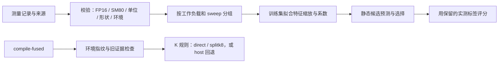

# 预测器代码定位、逻辑审查与修复

2026-10-20。本轮不改训练目标、不搜索超参数、不启动 GPU。
重点是确认调用关系，修复可复现的实现问题，并解释仍然存在的排序失败。

结论：修复后的 174 项 Python 测试通过，15 组方法/协议、395 次决策与修复前一致。
这说明有效历史数据的结果没有被校验修改改变；不说明预测器已具备可靠的性能保证。
P8 校偏后的平均选择损失仍为 8.65%，最坏仍为 64.14%。

## 代码入口与三条不同路径

| 位置 | 主要逻辑 | 当前用途 |
|---|---|---|
| [two_stage_selection.py](../../EDM-IR/edmir/compiler/two_stage_selection.py) | `AnalyticalScheduleFeatures`、`RidgeLatencyModel`、`TwoStageSelector` | 原绝对耗时预测器及交互项变体，离线评价 |
| [relative_selection.py](../../EDM-IR/edmir/compiler/relative_selection.py) | `ScheduleCandidate`、`RelativeCostSelector.fit/predict_log_ratio/select/calibrate_offset/explain` | 新的相对耗时预测器，离线实验 |
| [fused_selection.py](../../EDM-IR/edmir/compiler/fused_selection.py) | `select_fused_a2a_gemm`，环境/证据检查，K 阈值规则 | 当前 `compile-fused` 实际调用的选择路径 |
| [measurement_dataset.py](../../EDM-IR/edmir/compiler/measurement_dataset.py) | `load_selector_dataset` | 读取归一化数据、校验语义与历史角色 |
| [evaluate_relative_selector.py](../../EDM-IR/tools/evaluate_relative_selector.py) | `fit_method/score/evaluate` | 分组留出、P4→P8、四点校准的回顾性比较 |
| [debug_relative_selector.py](../../EDM-IR/tools/debug_relative_selector.py) | 旧结果逐项比对、最坏点特征贡献与训练覆盖 | 可重复的 CPU 调试入口 |



离线模型目前没有接入图中 `compile-fused` 的路径。
调用关系可从 `edmir/cli.py` 的 `_compile_fused` 查看。
默认未显式启用时仍回退 host，不能把离线模型的结果当成编译器已验证的自动选择能力。

还需区分 host 身份：当前离线数据中的 host 是逐源 NCCL + CUTLASS，
编译器旧入口的回退 target 是 NCCL + cuBLAS。旧 profile 引用的测量记录也以
NCCL + CUTLASS 为参照。它们都叫 host，但不能共享一个未注明实现的性能保证；
后续接入新预测器前必须明确候选、计时和基线身份。

## 原模型怎样做决定

每个候选先由 P、M、K、N、q、g 生成计数及代理特征，再标准化、做线性回归。
host 和 fused 分别拟合自然对数耗时，输出取指数还原为毫秒：

```text
log(T_host)  = b_h + w_h · standardized_features_host
log(T_fused) = b_f + w_f · standardized_features_fused
```

先选预测耗时最小的 fused 候选，再与预测 host 比较；
只有 `T_fused < T_host × (1 - minimum_fused_advantage)` 才准入。
默认 margin 为 0。它是经验拟合，不是由字节计数直接推出的确定耗时。

host 特征只有 FLOPs、unique remote bytes、local bytes 三项的 log2。
fused 原特征为 11 项，交互模型增加 `grouped×log2(K/q)`、
`underfill×log2(K/q)`。`underfill` 是网格不足的代理，不能直接解释成 occupancy。
新修正的 host Gamma 没有参与 host 回归，所以不会改变历史模型的预测值。

## 新模型怎样做决定

host 得分固定为 0，fused 得分估计 `log(T_fused/T_host)`。
训练目标是同一工作负载内所有候选对的 log 耗时差平方误差，
每个工作负载的总权重为 1。特征缩放只用训练数据；
同一套得分产生候选排序，不存在分别训练成对分类器造成的循环偏好。

推断只接收不含实测耗时的 `ScheduleCandidate`。
选择最小 fused 得分，然后与 `log(1-margin)` 比较。
P8 四点校准给所有 fused 得分加同一个偏置，只改变 host/fused 准入；
任何两个 fused 候选的得分差都不变。
`explain()` 现在能输出每个特征的原值、标准化值、系数及得分贡献。

训练代码是在拟合相对耗时误差，并没有直接优化最大选择损失。
也没有训练分布之外的误差上界或经过独立校准的置信区间。

## 已复现并修复的问题

修复前检查记录：[before_checks.json](before_checks.json)。
其中 11 项初始测试出现 34 个失败子情形和 1 个异常；
随后增加了目标函数和标签隔离检查，最终共新增 13 项测试方法。

| 问题 | 修复 |
|---|---|
| `FusedEvidence` 的 NaN 最大误差可绕过准入阈值；部分评价阈值也接受 NaN/Inf | 准入证据、计数、阈值和评分值检查有限性及范围；不合法证据报错，不能产生融合准入 |
| 旧选择器允许拿一个形状的 host 与另一个形状的 fused 比较，mapping 别名也未校验 | 同次选择检查形状、组和候选名称一致性 |
| 同一形状可以用不同 group_id 进入留组训练与测试；部分评分入口未拒绝训练/校准重叠 | 在分组入口拒绝重复归属；旧 K 边界评价、新相对模型评分检查相应训练/校准重叠 |
| q/g 对应的字节数、rho、CTA 数仅检查正数，可能混入每 rank 字节数或错误尾块计数 | 按当前均匀 FP16、基础 64×128 kernel 契约逐项复算；检查整数、canonical family、K/N 和 split-K 对齐 |
| `zip` 会静默截断错误长度的系数或缩放向量；零 scale 产生除零错误 | 推断前校验特征模式、全部向量长度、有限性、正 scale；溢出的预测拒绝评分 |
| 环境字符串相同就能把 P4 模型用于 P8 | 环境与其训练/校准 P 绑定；改变 P 必须换环境身份，跨环境预测须显式声明 |
| 数据 manifest 可以缺少文件哈希项；dtype、kernel、timer、环境 P 和覆盖数量未充分核对 | 必须覆盖两份归一化数据；核对固定 A100/FP16/SM80/墙钟契约、候选数、历史角色和重复测量关系 |
| host 的 Gamma 按合并 PM 网格计算，与逐源执行不符 | 改成单次 M 行 GEMM 的 CTA 数，同时修正 roofline 账本；总 FLOPs/字节数仍按每目的端计算 |

不合法输入现在明确报错，而不是悄悄选一个候选并声称可靠。
研究接口的异常不会自动变成一条新的编译器部署路径。

## 对最坏点的逐项追踪

机器可读记录：[verification/debug_summary.json](verification/debug_summary.json)。
完整重放：[verification/replayed_results.json](verification/replayed_results.json)。

`P=8, M=512, K=8192, N=512`，四点校偏后：

| 候选 | 预测耗时 / host | 实测耗时 / host |
|---|---:|---:|
| 模型选中的 splitk2 | 0.6889 | 1.1245 |
| 实测最优 splitk4_groupedn2 | 0.8565 | 0.6851 |

模型认为实际最优方案比选中方案慢 24.34%，实测却快 39.08%。
候选名称、评分方向、指数转换和结果索引在这里没有互换。

将“实际最优方案得分 − 选中方案得分”展开，主要项为：

| 特征项 | log 得分差贡献，正值表示模型更不看好实际最优方案 |
|---|---:|
| log_local_bytes | +0.22633 |
| log_q | −0.10613 |
| log_rho_n | +0.09060 |
| q_minus_one | +0.07688 |
| 其余项合计 | −0.06984 |

这两个候选的 Gamma 相同，rho 不同；模型中 rho 项的拟合方向在这个比较中
甚至对较低 rho 加了代价。特征之间存在耦合，不能把这个系数当成
“减少远端读取在物理上必然变慢”的结论，也不能凭这一个点手工改符号。

P4 中 grouped-N 标签只覆盖 M=64，而这个点要求推断 M=512 的 grouped-N。
偏置校准不会改变上表两条 fused 候选的顺序。
这些是模型能力和数据覆盖的问题；本轮校验修复后仍保留相同的失败。

## 验证范围与接下来的要求

- 174 项 Python 测试通过；本轮新增的测试包括错误输入、模型损坏、分组泄漏、
  环境 P 冲突、kernel 对齐和尾块、特征解释求和、评价标签扰动。
- 用中心化残差恒等式独立检查相对模型目标函数的梯度，而不是再写一遍配对正规方程。
  测试确认拟合系数在所声明的损失函数下达到数值驻点。
- 改动评价集耗时会改变评分，但不会改变新预测器选出的候选。
- 15 组方法/协议的指标在容差 1e-10 内一致，395 次选择及 oracle 身份全部一致。
  没有为了通过测试修改旧标签、增加训练点或调参。

这些检查支持“代码按所声明的规则执行”，尚不支持“模型能可靠预测未见工作负载”。
环境 ID 仍是数据声明，不能代替运行时硬件核验。
要建立后者的证据，需要先明确完整程序开销与组件耗时的关系、统一 host 基线，
再冻结模型并验证不同 M 的 grouped-N，以及真正未参与设计的独立点。
在此之前保留编译器默认关闭实验融合的行为。

在仓库根目录复查：

```bash
python3 -m unittest discover -s EDM-IR/tests -p '*test.py'
python3 EDM-IR/tools/debug_relative_selector.py \
  --dataset experiments/2026-10-20-offline-predictor/data \
  --reference experiments/2026-10-20-offline-predictor/relative_results.json \
  --out-dir /tmp/edmir-predictor-debug
```

输出目录需尚不存在。全程仅使用 CPU 与已有文件。
