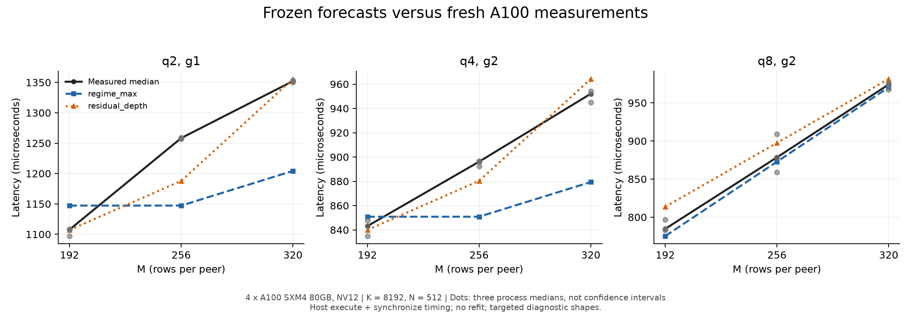

# 2026-10-25：一小时 A100 采集与验收

**采集、数值检查和本地回收已完成；预测器尚未通过自动选择验收。** 模型参数和冻结预测没有修改，也没有用新标签重训。

## 本轮交付

| 数据批次 | 配置数 | 独立进程 | 计时样本 |
|---|---:|---:|---:|
| 冻结主计划：57 个主配置 + 4 个预热诊断 | 61 | 183 | 18,300 |
| 57 个主配置完整复跑，单独保存 | 57 | 171 | 17,100 |
| 4 个原有形状，补合并 CUTLASS/cuBLASLt，并重测原 host | 12 | 36 | 3,600 |
| 合计 | 130 组配置重复 | **390** | **39,000** |

全部进程在计时前后按冻结的 `atol=rtol=0.02` 校验完整输出；计时后累计核对 699,924,480 个元素，没有非有限输出。最大绝对误差 0.03613281、最大相对误差 0.01464844，按原逐元素混合容差通过。预热和正确性检查耗时不进入计时样本。

原计划和附加基线没有质量标记；复跑有 1 个：M64/K1024/N512 的 q2g2 出现进程内漂移。每个进程的 100 个计时样本全部保留。两次采集不合并成一个标签；额外基线是读到第一轮结果后决定的补充，单独登记。

## 冻结模型的实际表现

下表使用两次各自完整的 57 个主配置，不因复跑的质量标记改变比较集合。选择损失的最优值只限于该阶段已测候选。P=4，形状顺序为 M/K/N；M 是每个 peer 的行数。

| 主模型 regime_max | 第一套 | 复跑 |
|---|---:|---:|
| 按形状平均的绝对相对误差 | 4.15% | 4.06% |
| 最大候选误差 | 23.29% | 22.20% |
| 方向错误 | 11/100 | 10/100 |
| 全部已测候选：最坏首选损失 | 6.50% | 6.17% |
| 原 host 与 fused 子集：最坏首选损失 | 12.61% | 13.55% |

复跑按原规则排除 1 个完整配置后，稳定子集为 56 个配置、95 对，主模型错 8 对。这个分母变化不代表模型变好了；完整集合仍保留在上表。第一套存在超过 10% 损失的错序，未满足预先声明的验收条件。挑战模型 `residual_depth` 的平均误差较低，但也保留错误，不自动替换主模型。

57 个配置的跨采集中位耗时变化，中位数为 0.26%、最大为 1.40%；实际库算法均未变化。100 对中只有 M320/K3072/N512 的 q2/q2g2 翻转方向：第一次相差约 0.49 μs，第二次约 3.60 μs。这个近边界点应保留不确定性。

两项主要错误则重复出现：

- M256/K8192/N512：q8−q2 实测分别为 **−79.18、−78.02 μs**，冻结预测 **+56.32 μs**。
- M64/K4096/N2048：q4g2−原 host 实测分别为 **+37.48、+35.61 μs**，冻结预测 **−7.24 μs**。

完整已测候选集合中，预先声明的 top-2 在两套结果里都保留了该集合最优项。这是事后回放分数，不是已经验证的在线两次测量策略；原 host/fused 子集的 top-2 仍会漏掉最优项。候选覆盖随形状不同，不能据此宣称普适 top-2 保证或 GPU 成本节省。

第一套有旧主数据集合之外的 8 个形状、26 个配置；它们仍由既有错误指导选点。新形状上的首选损失很小，但不能包装成完全独立的泛化测试。旧版 4.18% 等指标来自留形状验证，本轮是冻结全量标定后的预测；不能把两者直接相减当作改进。

## 本轮定位出的表达问题

固定 K8192、N512、q2，M192→256 时，实测约 1108→1258 μs，而主模型都给出 1147 μs。q4g2 也有类似的过平趋势；q8g2 则较好地跟随增长。当前 max 表达在部分区间抹掉了 M 的增长，不足以解释观测。计数恒等式没有因此被推翻；从计数映射到时间的函数需要重新审查。

这仍不是 SM、HBM、NVLink 或 semaphore 等待的因果定位。本轮计时是主机 `execute()+synchronize()`，没有采集 profiler 硬件计数。后续修改需明确哪些成本随 M、q、g 共同变化，不能把逻辑字节直接当实测流量。

## 强基线改变了比较对象

补充阶段的三种 host 使用相同输入、20 次预热、100 次计时和三次新进程，全部通过数值与稳定性检查：
三种 host 都由主机编排 GPU 通信和 GEMM；差别在于是否合并源块及使用的 GEMM 库。

| M/K/N | 原 host（μs） | 合并 CUTLASS（μs） | 合并 cuBLASLt（μs） |
|---|---:|---:|---:|
| 64/3072/1536 | 498.56 | 301.83 | 293.20 |
| 64/4096/2048 | 577.82 | 354.99 | 330.66 |
| 64/8192/512 | 824.74 | 428.63 | 362.97 |
| 192/3072/512 | 613.63 | 375.05 | 365.04 |

这些合并基线在上述形状中耗时低于原 host，也低于本轮已测的 fused 候选。论文不能用相对原 host 的提升代替对强基线的提升。新增候选没有事先冻结的独立预测记录，因此没有回填进原来的模型成绩。

基线也不是永远选 cuBLASLt：M64/K768/N512，合并 CUTLASS 第一套约 234 μs，cuBLASLt 约 251 μs；K1536 则由 cuBLASLt 胜出。复跑确认同样方向及完整算法配置。M512 的库排序也重现，但本轮全量标定预测正确不能抹去此前留形状测试的失败。

短 K 的 20/200 次预热对照中，四种 host 中位耗时变化都不到 0.9%。这是本轮的描述性结果；预热阶段执行时间不同，不能从中推断过去漂移的唯一原因。

## 数据和复现入口

- [验收记录](acceptance-result.json)、[回收完整性](recovery-verification.json)、[文件哈希清单](recovered/recovery-file-manifest.json)。
- [冻结执行包与运行协议](../2026-10-25-regime-gpu-validation/README.md)、[原执行包](../2026-10-25-regime-gpu-validation.tar.gz)。
- [第一套复核](review-primary-sealed.json)、[复跑复核](review-recheck-sealed.json)、[补充基线复核](review-baseline-extension-local.json)。
- [第一套分析](analysis-primary-v2.json)、[复跑分析](analysis-recheck.json)、[逐项复跑对照](recheck-comparison.json)。
- 原始记录在 `recovered/work/`、`recovered/work-recheck/`、`recovered/baseline-extension-01/`；压缩包为 `hour-01-results.tar.gz`。每个进程的 stdout、stderr、100 个样本、算法身份、context 和最终 seal 都保留。
- [绘图源码](plot_results.py)、[图表数据](m-sweep-data.json)、[分析源码](analyze-v2.py)、[独立指标复核](verify_metrics.py)。第一套 234 项、复跑 228 项选择结果交叉检查通过；合计 4,620 次排序输入重排检查通过，输入为已经冻结的候选分数。

执行身份保持为 10/21 的 CUDA/runtime/compiler 与 `resource_queues_v1`。**本轮没有验证后来修复的 runtime。** 机器是新分配的 4×A100 SXM4 80GB、全互联 NV12；CUDA 12.8.93、GCC 13.3、驱动 595.91.07 与旧清单一致，但物理设备、宿主机和构建身份单独记录。49 个 CUDA 实验程序构建完成，51 项构建附带检查通过。

测量边界如实保留：第一套 anchors 开始时短暂与文件回传重叠；已记录并完整复跑。重复 crossings 启动前的一次小文件同步未记录精确完成时刻，不能排除极短重叠。原始 crossings 与复跑 anchors/library 没有这个边界问题。详情见 [操作记录](operations-notes.json)。不因这些记录删样本、改阈值或推断性能变化原因。

部署只修正了上传依赖保留的 macOS 文件属主，修正后重验 8,670 个文件哈希通过；没有改依赖源码或关闭 Git 属主检查。原始失败日志也已回收。

## 下一步收敛

先在本地统一强 host 候选与计时边界，再修订 q/M/g 的时间表达，检查短 K host 和库算法切换。将这一轮明确划为开发证据，保留之后未参与修改的形状做验证。模型暂时只用于研究候选筛选；自动首选和论文加速主张都不能提前通过。
